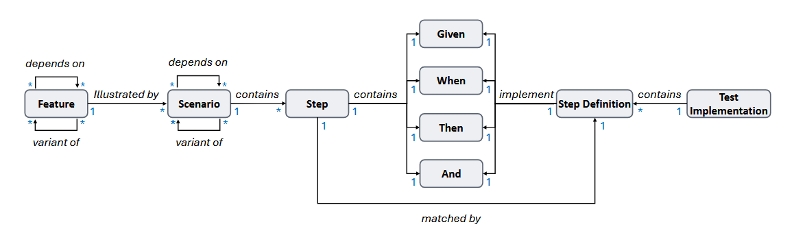

## 一、论文数据集链接


https://github.com/code-philia/Req2Test-Bench

## 二、与之前的工作不同之处

| 类型         | 测试目标从哪里来               |
| ------------ | ------------------------------ |
| 传统测试生成 | 方法、类、文件、代码修改或缺陷 |
| 本文         | 独立表达的自然语言需求         |

### Agent 数量与协作方式

本文采用的是**单 Agent 独立完成一个任务**，不是多个 Agent 协同完成。对于每个 Requirement-to-Test 实例，系统只启动一个通用编码 Agent，由它独立接收 Requirement、Target Interfaces 和经过隐藏处理的项目代码，并完成项目探索、文件编辑、命令执行以及最终测试代码生成。

## 三、一个简单例子



需求用gherkin语言（自然语言描述项目)：

```gherkin
Feature: 用户登录
Scenario: 正确密码登录
  Given 系统中存在用户 "Alice"
  When Alice 使用正确密码登录
  Then 登录应该成功
```

其中，一个 Feature 由一个或多个 Scenario 通过具体例子加以说明：

```
Feature：用户登录
├── Scenario：正确密码登录
├── Scenario：错误密码登录
├── Scenario：被锁定用户登录
└── Scenario：密码过期
```

Agent 至少需要生成三个 Step Definitions（BDD框架：行为驱动的开发）：

```python
@given('系统中存在用户 "{username}"')
def create_user(context, username):
    context.user = user_fixture.create(username)

@when('{username} 使用正确密码登录')
def perform_login(context, username):
    context.response = login_client.login(
        username,
        "correct-password"
    )

@then("登录应该成功")
def check_success(context):
    assert context.response.status_code == 200
    assert context.response.user.is_authenticated
```

但如果 user_fixture 和 login_client 在项目里不存在，Agent 还可能需要生成或连接相应的测试辅助代码：

```python
# helpers/user_fixture.py
def create(username):
    ...
```

```python
# helpers/login_client.py
def login(username, password):
    ...
```

## 四、如何评估：与开发者编写的真实测试做比较

```
实例 i
├── Agent 可见
│   ├── Feature
│   ├── Scenario
│   ├── Target Interfaces
│   └── 隐藏处理后的项目上下文
│
└── 仅评估器可见
    ├── Ground-truth Test Implementation（开发者编写的真实 Test Implementation）
    ├── API calls（真实测试调用的 API）
    ├── Coverage（真实测试的代码覆盖）
    └── Mutant kills（真实测试杀死的变异体）
```

## 五、实验结果

### 5.1 实验设置

论文评估了 8 种“Agent、模型与推理强度”的组合，包括 Aider、OpenHands、Claude Code 和 Codex CLI，以及 DeepSeek-V4.1-Flash、GPT-6 Luna、GPT-6 Sol 和 Claude Sonnet 5.5。

为了减少大量 Scenario 复用相同步骤定义所造成的重复，作者从完整数据集中选取了 **2,051 个实例**（来自 780 个 Feature）进行实验，并分别在两种项目视图下生成测试：

- **Target-hidden**：隐藏目标行为的实现，但保留其他生产代码的实现；
- **All-hidden**：隐藏项目中所有生产代码的实现，只保留接口声明。

两个最重要的指标是：

- **Pass@1**：生成的测试能否成功构建、绑定、执行并通过；
- **KillComplete@1**：生成的测试不仅能够通过，而且能够杀死真实测试杀死的全部变异体。论文将其作为测试是否具有行为充分性的主要指标。

### 5.2 主要结果：测试能够通过，不代表测试充分

Target-hidden 视图下，各配置在 8 个项目上的平均结果如下：

| Agent | 模型 | 推理强度 | Pass@1 | KillComplete@1 |
| --- | --- | --- | ---: | ---: |
| Aider | DeepSeek-V4.1-Flash | 关闭 | 9.7% | 4.5% |
| OpenHands | DeepSeek-V4.1-Flash | 关闭 | 32.7% | 18.1% |
| Claude Code | DeepSeek-V4.1-Flash | 高 | 80.5% | 34.4% |
| Claude Code | Claude Sonnet 5.5 | 高 | 80.9% | **35.9%** |
| Codex CLI | DeepSeek-V4.1-Flash | 关闭 | 57.6% | 23.6% |
| Codex CLI | DeepSeek-V4.1-Flash | 高 | **82.8%** | 33.8% |
| Codex CLI | GPT-6 Luna | 高 | 66.2% | 28.3% |
| Codex CLI | GPT-6 Sol | 高 | 73.5% | 31.3% |

